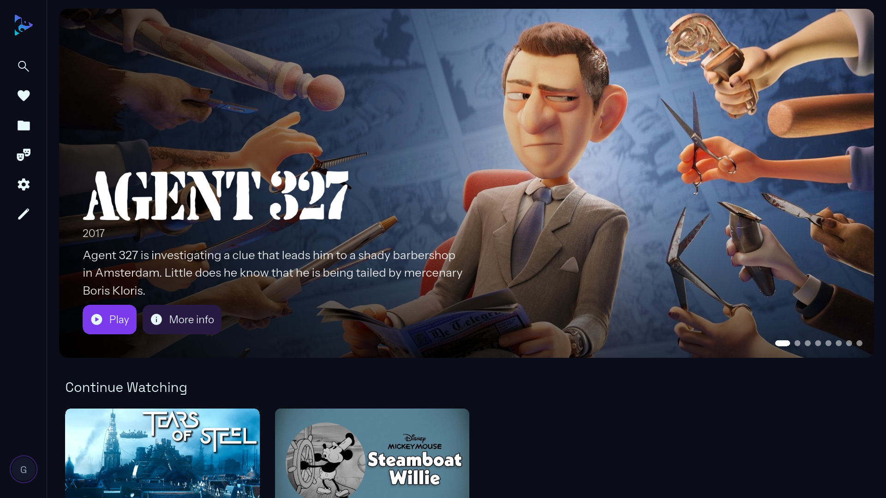
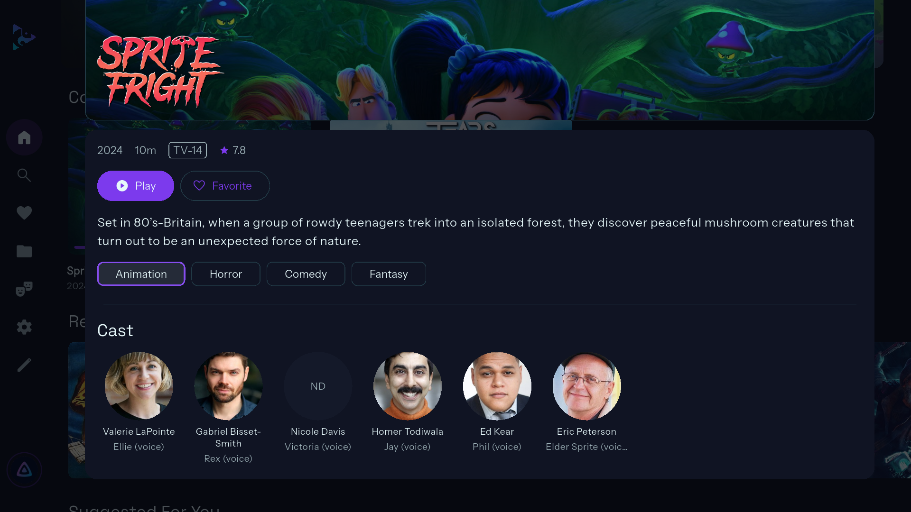
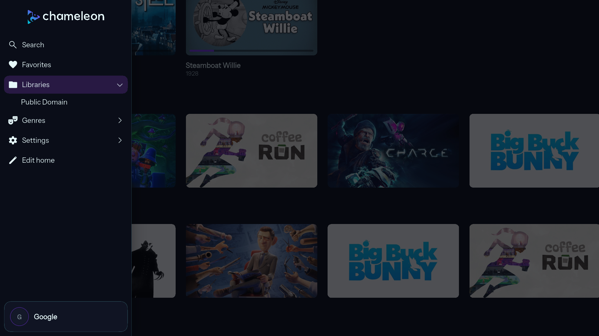
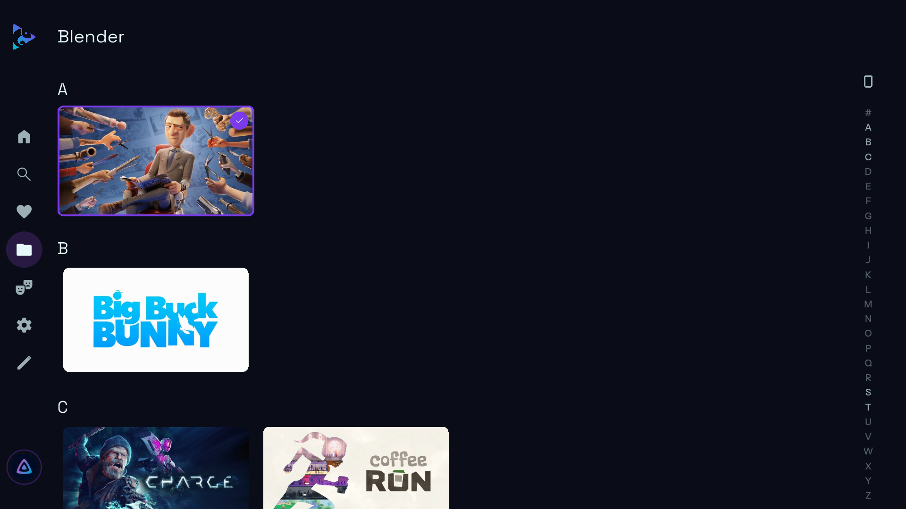
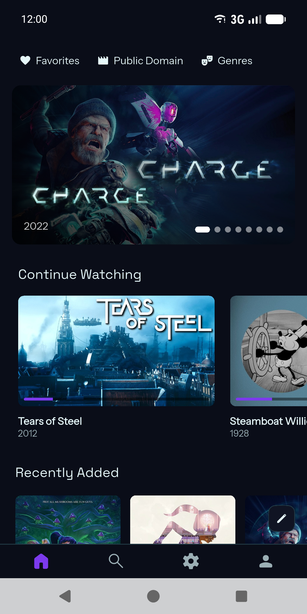
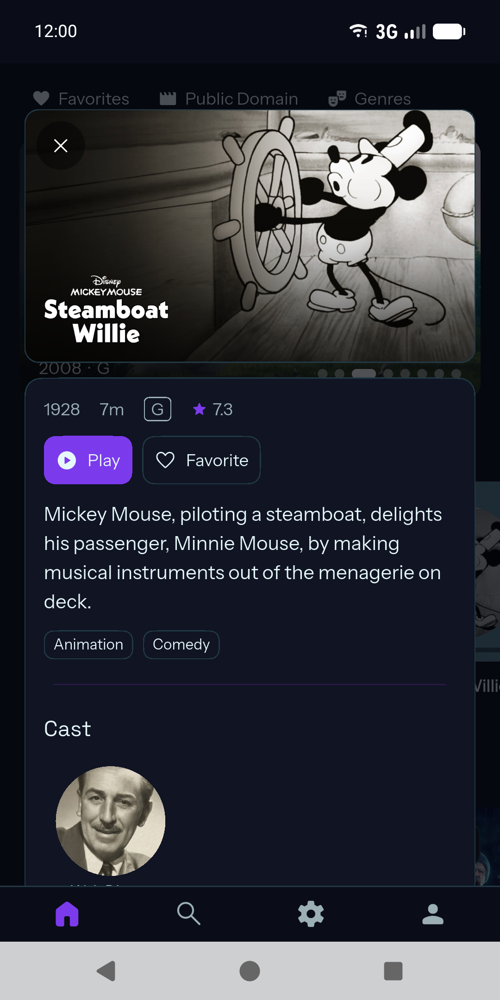
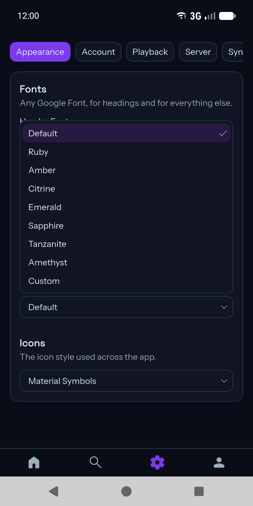
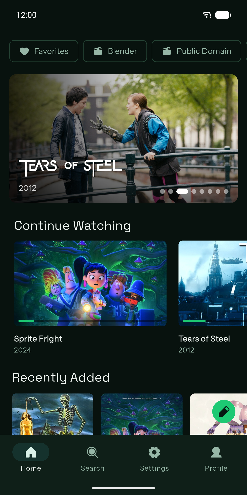

<div align="center">
  
</div>

# Chameleon

Chameleon is a deeply customizable [Jellyfin](https://jellyfin.org) client built on top of Flutter.

## Features

- **Browsing** — home modules you can add, remove and reorder (featured carousel, Continue
  Watching, Next Up, Recently Added, Suggested, "Because You Watched…", a collection, a
  genre), libraries with an A–Z jump column, genres, collections, favorites, search, and
  detail pages for movies, series and people.
- **Playback** — direct play and transcoding (automatic, or forced either way), styled text
  subtitles (including `.ass`/`.ssa`) with font, size, color, position and background all
  configurable, audio track and language selection, skip intro/recap/credits/previews, Up
  Next with an "Are you still watching?" prompt, and trickplay scrubbing thumbnails.
- **Chromecast**, and AirPlay for audio on iOS.
- **SyncPlay** — watch together with other Jellyfin clients, in sync down to the second.
- **Multiple accounts** on one device, with instant switching and a "Who's watching?"
  picker — no re-entering a password to switch.
- **Theming** — built-in presets, or a custom theme (simple hue/vibrance/depth steppers, or
  a full color-by-color editor), independent fonts for headings and body text from Google
  Fonts, and a choice of icon style (Material Symbols, Phosphor, Lucide, Cupertino, Fluent).
- **A customizable home layout**, with an in-place edit mode.
- No analytics, no trackers, no middleman server — the app talks to your Jellyfin server and
  (for fonts and casting) the services those specific features need, nothing else.

## Screenshots

**Android TV**

<p>
  
  
  
  
</p>

**Phone**

<p>
  
  
  
  
</p>

All screenshots, at store sizes (TV 1920 × 1080, phone 1080 × 2160), are in
[docs/screenshots](docs/screenshots). Titles shown are public-domain or Creative Commons films.

## Supported platforms

- Android TV (the primary target, driven by a D-pad remote)
- Android phones and tablets
- iOS
- Linux desktop

## Getting started

### Requirements

- [Flutter](https://docs.flutter.dev/get-started/install) (see `environment.sdk` in
  `pubspec.yaml` for the exact Dart SDK range)
- A Jellyfin server to connect to

### Clone and run

```bash
git clone https://github.com/jumpingfox-dev/chameleon.git
cd chameleon
flutter pub get
flutter run -d <device id>   # `flutter devices` lists what's available
```

See [docs/building.md](docs/building.md) for platform-specific build and run instructions.

## Connecting to a Jellyfin server

On first launch, enter your server's address and sign in with your Jellyfin username and
password, or select **Use Quick Connect** to sign in without typing a password: the app shows
a code, which you approve from another device that's already signed in (the Jellyfin web app,
or Chameleon's own Settings → Account tab). If your server authenticates through LDAP or
another external provider, sign in the normal way with that account's username and password —
Chameleon talks to Jellyfin's own authentication endpoint either way and doesn't need to know
how the server verifies you behind the scenes.

## Tech stack

- **Flutter**, with Material 3
- **[go_router](https://pub.dev/packages/go_router)** for routing, with a `StatefulShellRoute`
  for the four main tabs
- **[media_kit](https://pub.dev/packages/media_kit)** (mpv) for playback
- **[dart_jellyfin](https://pub.dev/packages/dart_jellyfin)**, plus direct `http` calls for
  the handful of Jellyfin endpoints the package doesn't wrap yet
- **[Drift](https://pub.dev/packages/drift)** (SQLite) for settings, accounts and saved pages

## Project layout

```
lib/
  main.dart            entry point and the top-level app widget
  app/                 routing and the shell (sidebar / bottom bar)
  core/                Jellyfin session, casting, remote focus, platform helpers -- no UI
  features/            auth, home, library, detail, player, settings, search
  theme/               Material theme, palettes, app icons, theme controllers
  widgets/             small widgets shared across features
```

See [docs/architecture.md](docs/architecture.md) for the full picture.

## Documentation

- [Architecture](docs/architecture.md) — screens, widgets, routing, where state lives
- [Remote navigation](docs/remote-navigation.md) — how D-pad focus works
- [Adding a screen](docs/adding-a-screen.md)
- [Adding a setting](docs/adding-a-setting.md)
- [Theming](docs/theming.md) — presets, the custom editor, fonts, icon styles
- [Home modules](docs/home-modules.md) — how home-screen sections work
- [Playback](docs/playback.md) — the player, direct play vs. transcode, subtitles, SyncPlay
- [Building](docs/building.md) — running and building on each platform

## Contributing

Issues and pull requests are welcome. For anything beyond a small fix, open an issue first to
talk through the approach. Run `flutter analyze` before submitting, and try to match the
existing comment style — plain English describing what the code does for the person using the
app, not ticket numbers or references to past conversations.

## License

<!-- No LICENSE file exists in this repository yet. Add one (MIT, Apache-2.0, GPL-3.0, etc.)
     and replace this section with the usual "Licensed under the X License — see LICENSE." -->
License to be decided.
